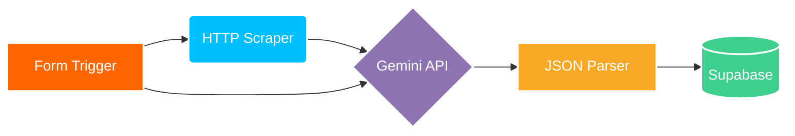
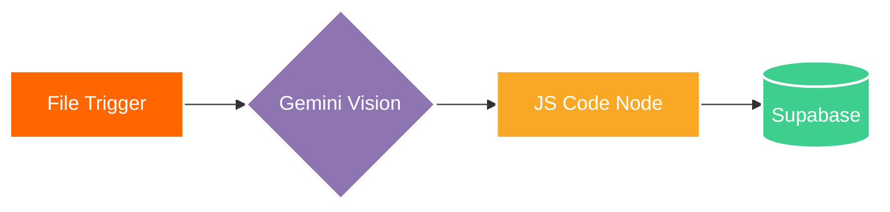
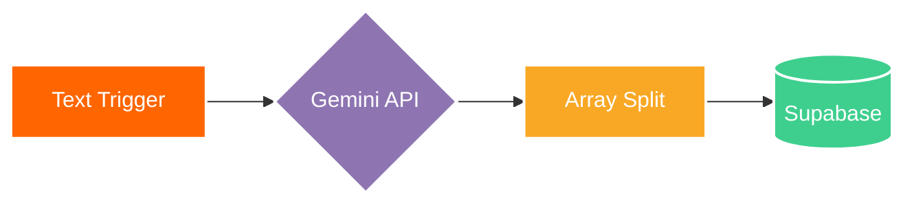

# AI Automation Learning Journal

Personal repository documenting my hands-on practice with backend workflow automation, API integrations, and LLM-driven data processing. 

Focusing on practical architecture: moving raw inputs through programmatic checks, passing structured payloads to AI models, and logging clean results into relational databases.

## Core Technical Concepts Explored
- **Deterministic Logic vs. LLM Tasks:** Using code and standard nodes for routing and filtering, reserving AI strictly for tasks requiring text understanding, extraction, or summarization.
- **Structured JSON Outputs:** Enforcing strict schemas on LLM responses to prevent downstream database breaks.
- **Error Resilience:** Configuring retry logic and fallback parameters to handle API traffic limits and server spikes.
- **Array Iteration (1-to-Many):** Transforming a single unstructured input bundle into multiple discrete database records using custom JavaScript mapping.

## Practiced Workflows

### 1. Lead Qualification and Enrichment Pipeline
- **Overview:** Evaluates inbound form data and enriches it with real-time website context.
- **Data Flow:** Web Form Trigger -> HTTP Request (Website Scraper) -> Gemini Flash (Scoring & Drafting) -> Custom JSON Parser -> Supabase PostgreSQL.

### 2. Document and Receipt Extraction Engine
- **Overview:** Uses multimodal vision capabilities to parse unstructured receipt and invoice images into structured accounting schemas.
- **Data Flow:** File Upload Trigger -> Gemini Vision API -> Sanitization Code Node -> Supabase Database.

### 3. Transcript Action Item Extractor
- **Overview:** Converts a single paragraph of meeting notes into multiple discrete, assigned task records.
- **Data Flow:** Text Input Trigger -> Gemini Array Generator -> JavaScript Array Iterator -> Supabase Tasks Table.

## Tech Stack
- **Automation Runner:** n8n (Local development instance)
- **AI Integration:** Google Gemini API via Google AI Studio
- **Data Layer:** Supabase / PostgreSQL
- **Version Control:** Git / GitHub
